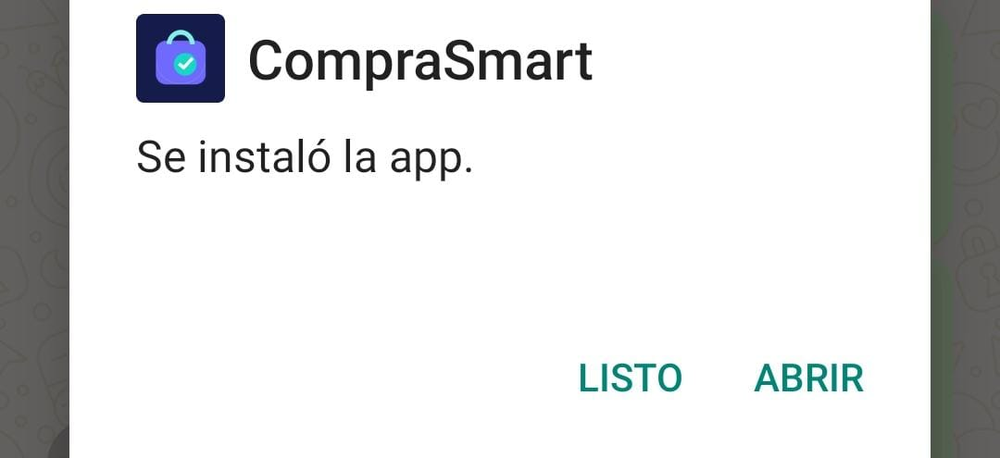
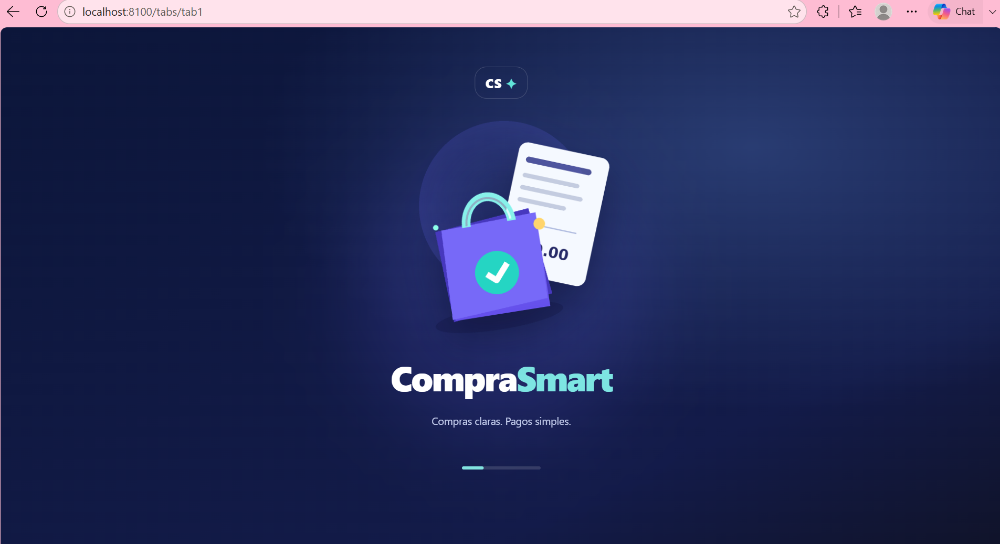
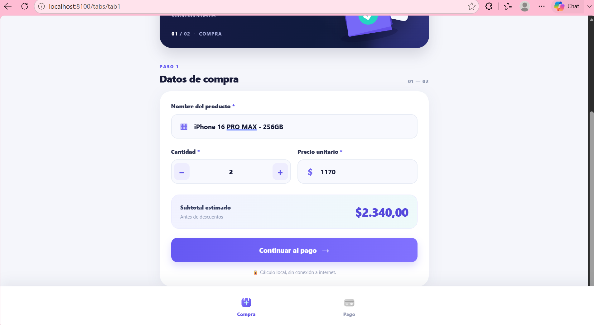
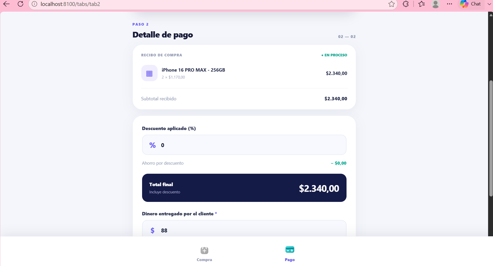
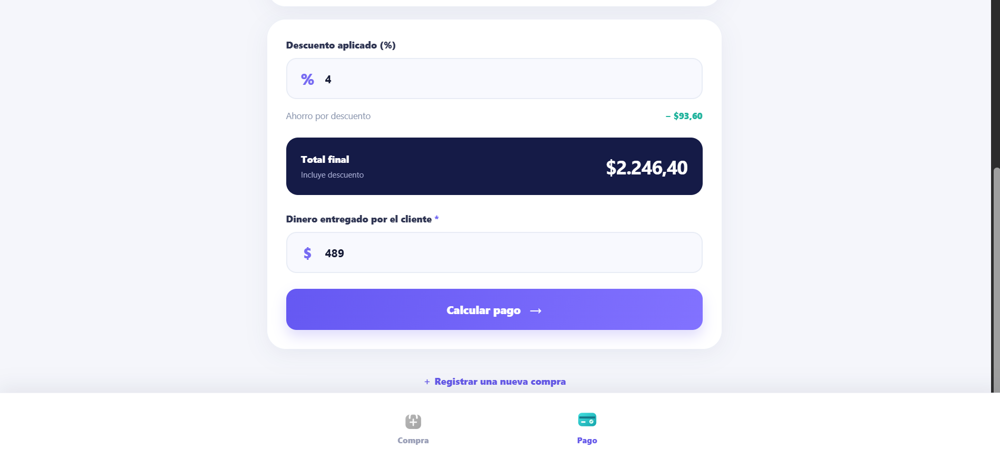
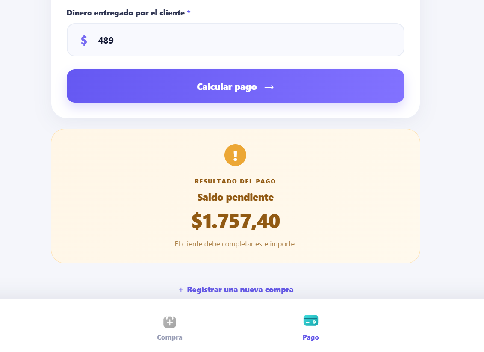

# CompraSmart — Compra y cálculo de pagos

Aplicación web y Android desarrollada con **Ionic, Angular (Standalone), TypeScript y Capacitor** para registrar la compra de un producto, aplicar descuentos porcentuales y determinar el cambio o saldo pendiente.

**Proyecto académico · Deber 2**  
**Evidencias incorporadas:** 15 de octubre de 2026

> **Estado:** aplicación compilada e instalada en un teléfono Android (compilación `assembleDebug` satisfactoria). Se incluyen evidencia del ícono personalizado durante la instalación, fotogramas reales del inicio en Android y video del arranque. Las capturas de cálculos de Compra y Pago proceden de la ejecución web.

---

## Vista previa

### Evidencia real en Android: ícono e inicio

| Ícono de la app durante la instalación | Imagen de inicio en Android |
|:---:|:---:|
|  |  |

**Video real del arranque:** [▶ Ver la grabación de CompraSmart en Android (MP4, ~8 s)](docs/video/inicio-android.mp4). Muestra la pantalla de inicio ilustrada y su transición al formulario Compra. La foto de instalación permite comprobar el ícono propio. El video es breve: no demuestra por sí mismo los cálculos de Pago; estos se documentan con las capturas posteriores.

### Vista de bienvenida (navegador)



### Compra y Pago

| Registro de compra | Detalle de pago |
|:---:|:---:|
|  |  |

| Descuento aplicado | Resultado: saldo pendiente |
|:---:|:---:|
|  |  |

> Las capturas de Compra y Pago corresponden a la ejecución **en navegador**, mientras que la evidencia de instalación, los fotogramas y el video superiores corresponden al teléfono Android. No se deben confundir los dos entornos.

## Objetivo

Registrar una compra con los datos de un único producto, validar la información ingresada y calcular el importe final después de aplicar un descuento. La aplicación determina si el dinero recibido alcanza para cubrir el pago y presenta el **cambio**, el **saldo pendiente** o el **pago exacto**.

## Funcionalidades

- **Compra:** nombre del producto, cantidad entera, precio unitario y subtotal automático.
- **Pago:** subtotal transferido entre pestañas, descuento porcentual, dinero entregado, total y resultado.
- **Validación:** no permite datos que infringen las restricciones del deber.
- **Navegación:** dos pestañas con íconos SVG personalizados.
- **Identidad visual:** paleta violeta/turquesa, tarjetas, pantalla de bienvenida ilustrada y recursos para ícono/splash nativos.
- **Cálculo local:** funciona sin servidor propio ni base de datos; mantiene el registro actual en memoria durante la sesión.

## Requisitos y validaciones

| Campo | Regla |
|---|---|
| Nombre del producto | Obligatorio; se rechaza vacío o solo espacios |
| Cantidad | Número entero mayor que cero |
| Precio unitario | Número mayor que cero |
| Descuento porcentual | Valor entre **0 y 100** inclusive |
| Dinero entregado | Número mayor o igual a **0** |

### Fórmulas

```text
Subtotal        = Cantidad × Precio unitario
Monto descuento = Subtotal × (Descuento / 100)
Total final     = Subtotal − Monto descuento
Cambio          = max(0, Dinero entregado − Total final)
Saldo pendiente = max(0, Total final − Dinero entregado)
```

Los montos se presentan en USD con dos decimales. Se utiliza formato de moneda según configuración regional `es-EC`.

### Ejemplo documentado

En las capturas suministradas se registra una compra de **2 unidades** a **$1.170,00** por unidad:

| Concepto | Importe |
|---|---:|
| Subtotal | $2.340,00 |
| Descuento 4 % | − $93,60 |
| Total final | $2.246,40 |
| Dinero recibido | $489,00 |
| **Saldo pendiente** | **$1.757,40** |

## Tecnologías

- **Angular 22.1.7**, con componentes *standalone* y `signals`.
- **Ionic Angular 9.0.8** e **Ionicons**.
- **Capacitor** para Android.
- **TypeScript, HTML, SCSS, SVG y PNG**.
- **`@capacitor/assets`** para generar íconos y recursos del splash nativo.
- **Android Studio / Gradle** para compilar y generar el APK.

> Las versiones de Angular e Ionic son las observadas durante la configuración de desarrollo; las demás dependencias se fijan en el `package.json` y `package-lock.json` del proyecto que se suba al repositorio.

## Estructura del proyecto

```text
compra-smart/
├── assets/                         # Recursos PNG de ícono y splash Android
├── docs/
│   ├── capturas/                   # Capturas web e imágenes reales de Android
│   ├── video/inicio-android.mp4    # Arranque grabado en teléfono Android
│   └── GUIA_EVIDENCIAS.md          # Inventario de evidencias
├── src/
│   ├── app/
│   │   ├── services/compra.service.ts
│   │   ├── tab1/                   # Vista Compra
│   │   ├── tab2/                   # Vista Pago
│   │   ├── tabs/                   # Navegación inferior
│   │   └── app.component.*         # Bienvenida ilustrada
│   ├── assets/
│   │   ├── icons/                  # Íconos SVG personalizados de pestañas
│   │   └── illustrations/          # Ilustración de bienvenida
│   ├── global.scss
│   └── styles/compra-smart.scss
├── android/                        # Proyecto Android (después de agregar Capacitor)
├── capacitor.config.ts
├── package.json                    # Generado por Ionic y actualizado con npm
├── package-lock.json
└── README.md
```

## Instalación y ejecución en Windows

### Requisitos

- Node.js y npm compatibles con Angular 22.
- Ionic CLI.
- Android Studio y Android SDK para la compilación móvil.
- Git para subir el repositorio.

### Ejecutar un repositorio ya completo

```cmd
cd /d C:\Users\pauly\compra-smart
npm ci
ionic serve
```

`npm ci` requiere que el repositorio contenga su `package-lock.json`; en caso de no existir, utilizar `npm install` y generar el archivo. La aplicación web se sirve habitualmente en `http://localhost:8100`. Tras una actualización de dependencias, si aparece el error `Cannot find module '@ionic/angular/standalone'`, el código incluido utiliza la ruta de Ionic 9 `@ionic/angular`.

### Integrar la documentación de la entrega en el proyecto existente

El ZIP de evidencias finales contiene **únicamente** el `README.md` y `docs/` (más instrucciones de publicación). Debe extraerse sobre el proyecto Ionic que ya está funcionando en el equipo. **No reemplaza** el código de `src/`, las dependencias del `package.json`, los archivos de configuración ni el proyecto `android/`.

El repositorio GitHub final sí debe incluir el **proyecto completo local**: componentes Angular, estilos, assets, configuración de Capacitor y los archivos del proyecto generados por Ionic. En el código de este proyecto se corrigieron las importaciones para Ionic 9 (`@ionic/angular`) y la señal reactiva de bienvenida para Angular 22.

## Compilar para Android

Desde la **raíz del proyecto**, detener el servidor web con `Ctrl + C` y ejecutar:

```cmd
npm install @capacitor/android @capacitor/splash-screen
npm install -D @capacitor/assets
npx cap add android
ionic build
npx @capacitor/assets generate --android
npx cap sync android
npx cap open android
```

Si Android ya se agregó, omitir `npx cap add android`.

En Android Studio, seleccionar el emulador o teléfono y ejecutar con **Run ▶**. Para crear el APK de pruebas:

```cmd
cd android
gradlew.bat assembleDebug
```

Ruta del APK generado:

```text
android/app/build/outputs/apk/debug/app-debug.apk
```

> El APK debug se utiliza para demostrar la aplicación; para publicación comercial debe generarse una versión firmada. Después de modificar código web: `ionic build` y `npx cap sync android`.

## Ícono, splash y pantalla de bienvenida

Los recursos para Android están en `assets/`:

- `icon-only.png`
- `icon-foreground.png`
- `icon-background.png`
- `splash.png`
- `splash-dark.png`

Los íconos de las dos pestañas están en `src/assets/icons/`. Para actualizar ícono y splash nativo Android:

```cmd
npx @capacitor/assets generate --android
npx cap sync android
```

**Diferencia entre los dos inicios:** el **splash nativo** aparece antes de que cargue la aplicación y depende de la versión de Android; la **bienvenida interna** es la pantalla con ilustración que se muestra al inicio. En Android 12 y posteriores, el sistema restringe el aspecto del splash nativo a un ícono central sobre fondo. Para demostrar ambos, grabar un video desde que se abre el ícono en el emulador.

## Casos de prueba

| Caso | Entrada | Resultado esperado |
|---|---|---|
| Nombre vacío | `" "` | Mensaje de error; no continúa a Pago |
| Cantidad inválida | `0` o `1.5` | Mensaje: debe ser entero mayor que 0 |
| Precio inválido | `0` o `-12` | Mensaje: precio mayor que 0 |
| Descuento fuera de rango | `-1` o `101` | Mensaje de descuento inválido |
| Dinero negativo | `-10` | Mensaje de monto inválido |
| Pago con cambio | 2 × $24,50; 10 %; $50 recibidos | Total $44,10; cambio $5,90 |
| Pago exacto | Total $44,10; $44,10 recibidos | Diferencia $0,00 |
| Saldo pendiente | Total $44,10; $20 recibidos | Pendiente $24,10 |
| Descuento del 100 % | 100 % | Total final $0,00 |

Esta tabla recoge las **pruebas que deben ejecutarse**; las capturas suministradas verifican el ejemplo de saldo pendiente, no todas las validaciones.

## Evidencias Android — incorporadas

Se incluyen evidencias **obtenidas en un teléfono real**, después de generar un APK de pruebas con Gradle:

| Archivo | Qué demuestra |
|---|---|
| [`docs/capturas/icono-instalacion-android.jpg`](docs/capturas/icono-instalacion-android.jpg) | Mensaje de instalación satisfactoria con el nombre e ícono personalizados de CompraSmart. |
| [`docs/capturas/inicio-splash-android.png`](docs/capturas/inicio-splash-android.png) | Fotograma de la imagen que aparece durante el inicio en Android. |
| [`docs/capturas/compra-android.png`](docs/capturas/compra-android.png) | Formulario Compra ejecutándose en el teléfono. |
| [`docs/video/inicio-android.mp4`](docs/video/inicio-android.mp4) | Video original (~8 segundos): imagen de arranque y transición al módulo Compra. |

La fotografía de instalación demuestra el **ícono de la app** y la grabación demuestra la **pantalla de inicio visible en el teléfono**. Con el video aportado no se distingue inequívocamente qué fotogramas corresponden al splash nativo de Android frente a la bienvenida HTML posterior; la configuración nativa se genera usando `@capacitor/assets` y puede verificarse abriendo la app tras cerrarla completamente.

Las capturas de Compra y Pago son de la versión web del mismo proyecto y documentan el subtotal, descuento y saldo pendiente. Se recomienda, como evidencia adicional opcional, una captura del ícono en el lanzador del teléfono y un video más largo del cálculo completo, pero el material recibido se ha incorporado íntegramente.

## Publicar el repositorio en GitHub

Crear en GitHub un repositorio **vacío** con nombre, por ejemplo, `compra-smart-ionic`, sin agregar un README inicial. Desde la carpeta del proyecto:

```cmd
git init
git add .
git status
git commit -m "feat: implementacion de CompraSmart con Ionic y Capacitor"
git branch -M main
git remote add origin https://github.com/TU_USUARIO/compra-smart-ionic.git
git push -u origin main
```

Sustituir `TU_USUARIO`. Si ya existe el remoto `origin`, utilizar `git remote set-url origin URL`. Revisar `git status` antes del commit y confirmar que **no se incluyan** `node_modules`, `www`, `.angular/cache`, carpetas de compilación de Android ni archivos con contraseñas. En particular, **no subir** `android/local.properties`, que contiene la ruta local del SDK. Las capturas y el video de `docs/` sí deben incluirse.

Cuando agregues las evidencias Android:

```cmd
git add README.md docs/capturas docs/video
git commit -m "docs: agregar evidencias de icono y splash en Android"
git push
```

El APK generado puede adjuntarse a una **GitHub Release** en lugar de incorporarse al historial de código.

## Alcance y limitaciones

- La aplicación registra **un producto por operación**.
- Los cálculos son locales y no procesan pagos bancarios reales.
- La compra está en memoria; puede perderse tras cerrar o recargar la app.
- Las evidencias web no sustituyen la comprobación nativa de Android.

## Documentación oficial

- [Ionic Angular](https://ionicframework.com/docs/angular/overview)
- [Capacitor](https://capacitorjs.com/docs)
- [Íconos y splash con Capacitor](https://capacitorjs.com/docs/guides/splash-screens-and-icons)
- [Android Studio](https://developer.android.com/studio)

---

**CompraSmart | Deber 2 · Ionic + Angular + Capacitor**
